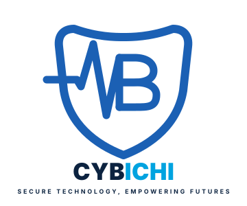

# CYBICHI — Secure Technology, Empowering Futures

<p align="center">
  
</p>

<p align="center">
  <strong>Transforming Healthcare & Business with Secure IT Solutions</strong><br>
  <em>Platform Corporate Hub, Direct Live Demo Showcase, E-Invoicing Engine, Digital MoU Generator & Admin Vault</em>
</p>

<p align="center">
  
  
  
  
  
  
</p>

---

## 📋 Daftar Isi
1. [Tentang CYBICHI](#-tentang-cybichi)
2. [Fitur Utama Sistem](#-fitur-utama-sistem)
3. [Arsitektur & Tech Stack](#-arsitektur--tech-stack)
4. [Katalog Demo Sistem yang Tersedia](#-katalog-demo-sistem-yang-tersedia)
5. [Struktur Direktori](#-struktur-direktori)
6. [Panduan Instalasi & Menjalankan Lokal](#-panduan-instalasi--menjalankan-lokal)
7. [Akun Administrator Default (Admin Vault)](#-akun-administrator-default-admin-vault)
8. [Pengujian Otomatis (Testing)](#-pengujian-otomatis-testing)
9. [Standar Keamanan Siber](#-standar-keamanan-siber)
10. [Identitas Perusahaan & Lisensi](#-identitas-perusahaan--lisensi)

---

## 🌟 Tentang CYBICHI

**CYBICHI** (PT Cybichi Teknologi Nusantara) adalah ekosistem digital terpadu yang memadukan keahlian rekayasa perangkat lunak enterprise, solusi **Healthcare IT** (sistem rumah sakit, antrean poliklinik, rekam medis), infrastruktur jaringan telekomunikasi berkecepatan tinggi, dan tata kelola keamanan informasi (*defense-in-depth*).

Website ini berfungsi sebagai:
- **Pusat Etalase & Live Demo Showcase**: Klien korporat dan faskes dapat langsung menguji aplikasi web, ERP, dan POS tanpa batasan iframe, lengkap dengan kredensial uji coba sekali klik.
- **Generator E-Invoice & MoU Digital**: Generator dokumen hukum dan penagihan resmi dengan tanda tangan kriptografi SHA-256 dan kode QR verifikasi publik.
- **Admin Control Center (Vault)**: Dashboard back-office untuk mengelola prospek (leads WhatsApp), siklus kontrak kerja, pemantauan status kesehatan server demo, dan audit trail keamanan.

---

## 🚀 Fitur Utama Sistem

### 1. Direct Tab Live Demo Showcase
- **Outbound Link Tracker (`/go/demo/{slug}`)**: Membuka aplikasi demo di tab baru tanpa hambatan isolasi header `X-Frame-Options` dari domain pihak ketiga, sekaligus mencatat metrik klik secara real-time.
- **Akun Uji Coba Transparan**: Fitur salin instan (*one-click clipboard copy*) untuk akun tester (Owner, Manager, Kasir, Dokter Poli, Petugas Loket).
- **Health-Check Server**: Indikator status langsung (*Live Online* / *Maintenance*) dengan fitur pengecekan uptime otomatis oleh Admin.

### 2. Generator E-Invoice Resmi & QR Kriptografi
- Pembuatan faktur digital profesional (format PDF A4) mencakup nomor invoice unik, detail termin pembayaran, rincian PPN, rekening bank perusahaan, dan klausul garansi sistem.
- Dilengkapi **QR Code Verifikasi SHA-256** yang mengarahkan pembaca dokumen ke portal verifikasi keaslian publik (`/verify/doc/{hash}`).

### 3. Generator Dokumen Perjanjian Kerja Sama (MoU / SPK)
- Pembuatan naskah kontrak legal kerja sama multi-pasal (Ruang Lingkup, Hak & Kewajiban, Termin Biaya, Jaminan Keamanan Data & Kerahasiaan, serta Force Majeure).
- Portal penandatanganan dan unduh mandiri dokumen oleh klien rekanan (`/doc/view/{uuid}`).

### 4. Pipeline Prospek & Integrasi WhatsApp
- Formulir konsultasi proyek yang terlindungi dari spam bot melalui rate-limiting ketat.
- Meneruskan data kebutuhan klien secara otomatis ke pesan WhatsApp Admin resmi.

### 5. Admin Back-Office Vault
- Autentikasi ketat dengan proteksi *brute-force rate limiting*.
- Manajemen katalog produk & domain demo.
- Manajemen master data klien rekanan.
- Pengelolaan status faktur tagihan (*draft*, *unpaid*, *partial DP*, *paid*, *cancelled*).
- Manajemen siklus naskah MoU (*draft*, *sent*, *signed*, *active*, *expired*).
- Modul pengaturan CMS identitas legal (rekening bank, NPWP, jam operasional, teks hero).
- **Audit Trail Log**: Pencatatan riwayat setiap aksi administrator secara lengkap (IP Address, User Agent, aksi, dan waktu eksekusi).

---

## 🛠️ Arsitektur & Tech Stack

| Komponen | Teknologi yang Digunakan | Keterangan |
| :--- | :--- | :--- |
| **Backend Core** | PHP 8.5+ & Laravel 13.x | Arsitektur MVC, Eloquent ORM, Strict Security Middleware |
| **Frontend Style** | Tailwind CSS v4.0.0 | Pure modern utility-first CSS via `@tailwindcss/vite` |
| **Asset Pipeline** | Vite 8.3.5 | Hot Module Replacement (HMR) & build produksi ultra-cepat |
| **Interactive JS** | Alpine.js 3.17+ | Interaksi UI reaktif ringan (dropdown, modal, clipboard toast) |
| **Tipografi** | Google Fonts | *Plus Jakarta Sans* (Heading), *Inter* (Body), *JetBrains Mono* (Code) |
| **PDF Engine** | Barryvdh DomPDF 3.1 | Rendering faktur dan MoU berstandar cetak A4 |
| **QR Code Engine** | Chillerlan PHP QRCode 6.0 | Pembuatan barcode verifikasi digital dokumen |
| **Basis Data** | MySQL 8.0+ / SQLite 3 | Mendukung skema relasional lengkap dengan seeder bawaan |

---

## 📦 Katalog Demo Sistem yang Tersedia

Aplikasi telah dilengkapi seeder data produk siap uji coba:

1. **AntreanRS** (`PRD-MED-001`): *Hospital Smart Queue & Medical Check-In Hub* (Healthcare IT).
2. **Metani** (`PRD-WEB-001`): *Smart Agriculture & Commodity Marketplace*.
3. **Ngafe** (`PRD-WEB-002`): *Intelligent Coffee Shop POS & Multi-Outlet Inventory*.
4. **Bilasin** (`PRD-WEB-004`): *Smart Laundry & Dry Clean Operational System*.
5. **Fastion** (`PRD-WEB-005`): *Modern Fashion Retail POS & Omnichannel Inventory*.
6. **Perpus Online** (`PRD-WEB-006`): *Enterprise Digital Library & E-Catalog System*.
7. **ISP Corporate Network** (`PRD-NET-001`): *MikroTik Hotspot & Dedicated Bandwidth Controller*.

---

## 📁 Struktur Direktori

```text
cybichi/
├── app/
│   ├── Http/
│   │   ├── Controllers/
│   │   │   ├── Admin/         # Controller Back-Office (Invoice, MoU, Produk, Audit)
│   │   │   ├── HomeController.php
│   │   │   ├── ProductCatalogController.php
│   │   │   ├── DocumentPortalController.php
│   │   │   └── DemoRedirectController.php
│   │   └── Middleware/        # AdminAuth, SecurityHeaders, RateLimiting
│   └── Models/                # Product, ServiceCategory, Client, Invoice, Agreement, SiteSetting, AuditLog
├── database/
│   ├── migrations/            # Skema tabel database
│   └── seeders/               # Data awal lengkap produk, paket, setting, dan user admin
├── public/
│   ├── assets/images/         # Aset logo vektor SVG (primary, white, stacked, emblem)
│   ├── favicon.svg            # Favicon tab browser format vektor
│   └── favicon.ico            # Favicon kompatibilitas retro
├── resources/
│   ├── css/app.css            # Desain sistem Tailwind CSS v4
│   ├── js/app.js              # Script Alpine.js & clipboard toast helper
│   └── views/
│       ├── layouts/           # app.blade.php (Tema Terang) & admin.blade.php
│       ├── pages/             # Beranda, Katalog Produk, Verifikasi Dokumen
│       ├── admin/             # View back-office (Dashboard, Invoices, Agreements, Leads)
│       └── pdf/               # Template cetak PDF Invoice & MoU resmi
├── routes/
│   └── web.php                # Rute publik, portal dokumen, dan rute aman /admin
└── tests/
    └── Feature/               # CybichiFeatureTest (pengujian keamanan & alur bisnis)
```

---

## 💻 Panduan Instalasi & Menjalankan Lokal

### Prasyarat Sistem
- **PHP** &ge; 8.3 (direkomendasikan PHP 8.5)
- **Composer** &ge; 2.x
- **Node.js** &ge; 20.x dan **npm** &ge; 10.x
- **MySQL** &ge; 8.0 atau **SQLite**

### Langkah-Langkah Instalasi

1. **Masuk ke direktori proyek**:
   ```bash
   cd /home/thodie/Code/proyek/cybichi
   ```

2. **Pasang dependensi PHP**:
   ```bash
   composer install
   ```

3. **Pasang dependensi Node.js**:
   ```bash
   npm install
   ```

4. **Konfigurasi Environment**:
   Salin berkas `.env.example` ke `.env` (jika belum ada):
   ```bash
   cp .env.example .env
   php artisan key:generate
   ```

5. **Pengaturan Database**:
   Sesuaikan konfigurasi database pada berkas `.env`:
   ```env
   DB_CONNECTION=mysql
   DB_HOST=127.0.0.1
   DB_PORT=3306
   DB_DATABASE=cybichi
   DB_USERNAME=root
   DB_PASSWORD=admin123
   ```

6. **Jalankan Migrasi & Seeder Data Awal**:
   ```bash
   php artisan migrate:fresh --seed
   ```

7. **Kompilasi Aset Frontend (Vite)**:
   ```bash
   # Untuk produksi
   npm run build

   # Atau untuk mode pengembangan (hot reload)
   npm run dev
   ```

8. **Jalankan Server Lokal**:
   ```bash
   php artisan serve
   ```
   Aplikasi publik dapat diakses melalui: [http://127.0.0.1:8000](http://127.0.0.1:8000)

---

## 🔐 Akun Administrator Default (Admin Vault)

Halaman login back-office: [http://127.0.0.1:8000/admin/login](http://127.0.0.1:8000/admin/login)

| Peran | Email | Kata Sandi | Hak Akses |
| :--- | :--- | :--- | :--- |
| **Super Admin** | `admin@cybichi.com` | `admin123` | Akses penuh seluruh sistem, audit log, legal CMS & keuangan |
| **Operations Lead** | `editor@cybichi.com` | `admin123` | Manajemen produk, demo hub, dan penerbitan invoice |

> [!WARNING]
> Segera perbarui kata sandi default di lingkungan produksi melalui menu pengaturan akun administrator!

---

## 🧪 Pengujian Otomatis (Testing)

Proyek ini telah dilengkapi serangkaian pengujian fitur (*feature testing*) untuk memastikan reliabilitas alur kerja dan keamanan rute:

```bash
php artisan test
```

Cakupan pengujian otomatis meliputi:
- Respons homepage publik dan verifikasi keberadaan **Strict Security Headers**.
- Navigasi etalase katalog produk dan halaman detail spesifikasi.
- Pelacakan dan pengalihan aman URL demo (*outbound redirect tracker*).
- Mekanisme **Rate Limiting** dan pemblokiran otomatis saat terjadi kegagalan login berulang pada Admin Vault.

---

## 🛡️ Standar Keamanan Siber

CYBICHI mengimplementasikan standar keamanan kelas enterprise:
- **Origin-Aware CSRF Protection**: Mencegah pemalsuan permintaan lintas domain.
- **Strict Content Security Policy (CSP)** & Header Keamanan:
  - `X-Frame-Options: SAMEORIGIN` (Mencegah serangan *Clickjacking*).
  - `X-Content-Type-Options: nosniff` (Mencegah eksploitasi tipe MIME).
  - `Referrer-Policy: strict-origin-when-cross-origin`.
- **In-Memory Rate Limiting**: Pembatasan kuota submission formulir konsultasi dan rute sensitif autentikasi.
- **Audit Trail Logging**: Seluruh perubahan dokumen penagihan dan kontrak tercatat secara kronologis beserta alamat IP dan agen peramban.

---

## 🏢 Identitas Perusahaan & Kontak Resmi

- **Perusahaan**: PT CYBICHI TEKNOLOGI NUSANTARA
- **NPWP**: `01.234.567.8-901.000`
- **Kantor**: CYBICHI Tech Tower Lt. 12, Jl. Jend. Sudirman Kav. 45, Jakarta Selatan 12190
- **Email**: [halo@cybichi.com](mailto:halo@cybichi.com)
- **WhatsApp Dedicated**: +62 812-9988-7766
- **Jam Layanan**: Senin – Jumat: 08.30 – 17.30 WIB

---

## 📄 Lisensi

Hak Cipta &copy; 2026 PT CYBICHI TEKNOLOGI NUSANTARA. Seluruh hak cipta dilindungi undang-undang.
Perangkat lunak ini dikembangkan di bawah lisensi kepemilikan internal CYBICHI.
